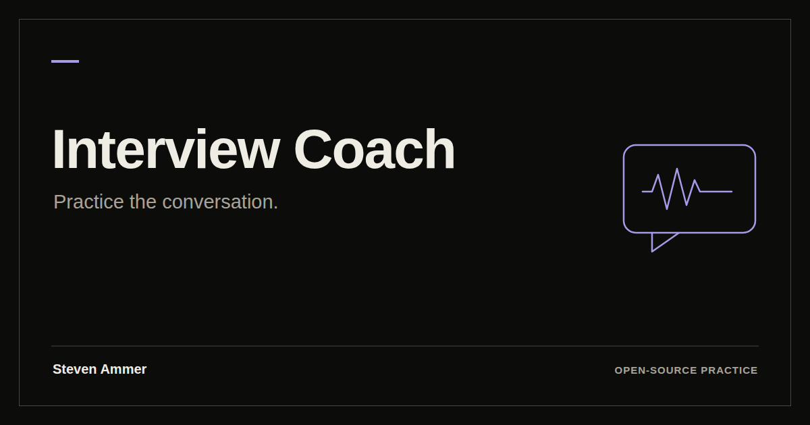

# Interview Coach

Interview prep built around facts you confirm.

You paste your résumé and a job posting. The app pulls out the claims in your résumé and shows the exact line each one came from. You confirm what's true. Then you practice a mock interview (typed or by voice), and the debrief and practice cards are built from those confirmed facts, not from guesses.

[](https://github.com/stevenammer/interview-coach/actions/workflows/ci.yml)

**Try the live version:** [ammer-interview-coach-app.netlify.app](https://ammer-interview-coach-app.netlify.app). It's free, and you can practice as a guest without an account. It runs under daily spend limits, so if a day's budget runs out it pauses until tomorrow instead of running up a bill. Every limit is listed in [docs/SPEND_GUARDS.md](docs/SPEND_GUARDS.md).

> **The example workspace is real.** It's Steven Ammer practicing in public for a Sales Training Academy team lead role at his current employer. It's built from public information and his own words. No employer materials are used. This project isn't affiliated with or endorsed by any employer.

I built it for a real job search. It's a working side project, not a polished product.

[](https://ammer-interview-coach-app.netlify.app/)

## Practice in public

The example workspace is work in progress. The answers are drafts, each marked "draft, still practicing", and the gaps say `[add a real example]` until there's a true story to put there. It only describes the role at the level a stranger could know: teach and coach new sales agents on the phones. Nothing about the role's internal details is claimed. The role pack behind it uses public frameworks only (Knowles on adult learning, the GROW coaching model, Kirkpatrick's four levels).

## Who it's for

- People preparing for a specific interview who want to practice with their own real stories.
- Developers who want a small, readable example of an AI app that checks its output against source text instead of trusting it.

## Honest limitations

- AI feedback can be wrong. Treat it as a practice partner, not a judge. The app checks some things in code (quotes must appear in your text, numbers must appear in the facts you cite), but it can't catch everything.
- This is not career, hiring, or legal advice.
- The hosted setup targets Netlify (Netlify Functions, Netlify Database, Netlify Blobs). There's a local dev server, but file uploads are off there.
- The hosted app supplies its AI connection; guests don't need an API key. If you self-host, configure your own Gemini Developer API or Vertex AI key. The practice workspace can be inspected without generating an AI response; new AI steps need a configured provider.
- Voice is optional. Self-hosting voice needs a Retell account and the vendored browser client. The latest release checks verified live text AI and offline voice behavior; they did not include a real voice call.
- Storage and rate limits are conservative side-project defaults. See `SECURITY.md` before allowing untrusted accounts.
- Accounts are username and password only. There's no password reset or email. Whoever runs the site resets passwords by hand.
- English only. No accessibility audit beyond basic labels and keyboard use.
- The Google font stylesheet is loaded from Google (see Privacy).

## Features

Taken from the code (`public/index.html`, `netlify/functions/api.mjs`):

- Add a job: paste or upload a résumé and posting (PDF, Word, or text; screenshots are read by the model). File uploads need the blob store, so they work on Netlify, not in the local dev server.
- Fact ledger: extracted claims, each tied to a quote. You confirm, edit, or reject. Conflicting claims are flagged for review.
- Job hub: lines up what the posting asks for with your confirmed facts, and compares saved jobs (pay, benefits, work mode, interview date).
- Mock interview in text or by voice: recruiter screen, hiring manager, panel, or senior executive. Adjustable follow-up depth.
- Debrief after each run, with a way to flag a bad debrief.
- Story dig: guided questions that turn a vague memory into a specific story, which you confirm before it's used.
- Practice cards: spaced-repetition review (FSRS) of details from your confirmed facts.
- Job Immerser: a simulated week in the role.
- Prep Pack: a one-page plan for a specific interview.
- Résumé and cover letter drafts built only from confirmed facts, with a check that numbers appear in the facts cited. Export to PDF and Word.
- Real-interview review: add notes after an actual interview.
- Job-hunt tracker: status and history per job.
- Plain English toggle: rewrites coach and interviewer messages in everyday words, with checks that numbers and names aren't changed.
- Guest mode (data in the browser tab) and a real, public practice workspace (see above).
- Per-day spend cap on model calls, rate limits, and account deletion.

## Quick start (local)

Needs Node 22.22 or newer. The checked runtime is Node 22.23.1 (see `.nvmrc`).

```sh
git clone https://github.com/stevenammer/interview-coach.git
cd interview-coach
npm ci
export GEMINI_API_KEY=your-key     # or put values in .env and run: npm run dev:env
npm run dev
```

Open http://localhost:8888. Data is kept in `./data/pglite`. Use `DEV_DB=memory npm run dev` for throwaway data. The dev server makes up a random `ABUSE_HMAC_KEY` if you don't set one.

## Deploy on Netlify

1. Create a Netlify site from your copy of this repo and add a Netlify Database. The build prepares `netlify/database/migrations` in `.netlify/runtime-migrations` for Netlify's native migration step before publication.
2. Set the environment variables below in the site settings.
3. Deploy with the Netlify CLI or your usual workflow. Read the Netlify docs for current steps; this README doesn't pin them.

Deployed sites require `VERTEX_API_KEY` (the code refuses to fall back to another provider on Netlify). `GEMINI_API_KEY` works for local use.

For an existing database that already applied `023_spend_guard_subject.sql` with the same SQL as canonical `024_spend_guard_subject.sql`, set the build environment variable `IC_MIGRATION_HISTORY=legacy-spend-23`. This prepares the already-applied SQL under its historical name and puts the resource guard at 024. New databases should leave the variable unset. Verify the actual migration history and target database before deployment, including previews. Legacy mode changes only the generated artifact names: compare `.netlify/runtime-migrations` with production history. Never rename or rerun canonical SQL just to silence a filename mismatch in a status tool. Never edit applied migration SQL.

## Configuration

Names only are in `.env.example`. Never commit real values.

| Variable | Required | What it does |
| --- | --- | --- |
| `GEMINI_API_KEY` | One of the two for local use | Gemini Developer API key |
| `VERTEX_API_KEY` | Required on Netlify | Vertex AI key. Wins over `GEMINI_API_KEY` when set |
| `ABUSE_HMAC_KEY` | Yes (dev server makes one) | Random secret, 24+ characters, for rate-limit identities |
| `DAILY_USD_CAP` | No (default 15) | Daily model spend cap. An invalid value blocks model calls |
| `GEMINI_MODEL_PRIMARY`, `GEMINI_MODEL_FALLBACK` | No | Override default model names in `src/model.js` |
| `ALLOWED_ORIGINS` | No | Comma-separated origins allowed to POST to `/api` (default: same origin) |
| `RETELL_API_KEY`, `RETELL_AGENT_ID`, `RETELL_GUEST_AGENT_ID`, `RETELL_WEBHOOK_KEY` | Voice only | Retell voice interview setup |
| `SIGNED_IN_MAX_CALL_MINUTES`, `GUEST_MAX_CALL_MINUTES`, `VOICE_MAX_MINUTES`, `VOICE_DAILY_MINUTES_LIMIT`, `GUEST_VOICE_*` | No | Voice call limits |
| `IC_MIGRATION_HISTORY` | Existing legacy deployments only | `legacy-spend-23` preserves an already-applied historical migration order; leave unset for new databases |
| `PORT`, `DEV_DB` | No | Dev server port and `memory` mode |
| `PLAYWRIGHT_DIR` | No | Where the browser scripts find Playwright |

Model prices in `src/model.js` drive the spend guard. They're estimates, not invoices. Check your provider's prices before you run a real key. Models without a reviewed price entry are refused before dispatch. Requests larger than 4 MB are refused. Known-model reservations use a conservative byte-based input estimate plus the output-token limit, with a minimum hold of $0.25. Unknown outcomes and missing usage keep the hold for that UTC day; elapsed time alone does not refund it. Provider billing remains authoritative.

Voice setup: `RETELL_API_KEY=... node scripts/retell/create-agent.mjs` creates the Retell agent from `docs/retell/interviewer_prompt.md` and writes ids to `scripts/retell/agent.json` (git-ignored).

## Architecture

- `public/`: plain JavaScript single-page front end, no framework. `app.js` is the main file. `vendor/` holds third-party bundles (pdf.js, mammoth, Retell client, fonts) with their licenses.
- `netlify/functions/api.mjs`: one JSON endpoint, `POST /api?op=<name>`. Other functions handle background model jobs and the voice webhook.
- `src/`: the logic. `service.js` (coaching flows), `model.js` (Gemini/Vertex adapter and spend guard), `repository.js` (SQL), `auth.js`, `truth.js` and `fact-conflicts.js` (checking claims against source text), `fsrs.js` (spaced repetition), `voice.js` (Retell), `plain.js` (Plain English).
- `netlify/database/migrations/`: Postgres schema, numbered migration files. Never edit an applied migration; add a new one.
- `scripts/dev-server.mjs`: local server using PGlite.

## Tests

```sh
npm test
```

Tests run offline against the real migration SQL in PGlite. The model is faked, so no keys are needed. Browser scripts in `scripts/e2e` need Playwright (`PLAYWRIGHT_DIR`) and aren't part of `npm test`. `scripts/live` holds smoke tests that call a real model and cost money; they require explicit `ALLOW_LIVE_MODEL_CALLS=1` and aren't run by default.

## Where data is stored

- Signed-in accounts: Postgres (Netlify Database when deployed, PGlite locally). That includes your résumé text, job postings, facts, practice answers, debriefs, and password hashes (scrypt). Uploaded files go to Netlify Blobs on deploys. Delete account removes your rows and uploads.
- Guest mode: your work lives in the browser tab's `sessionStorage`. The server gets the bounded data it needs with each request, processes it, and doesn't keep it. It stores only content-free spend and abuse counters. End session clears it.
- Résumé and cover letter drafts are also cached in `localStorage` in your browser.
- The default handler does not persist Plain English rewrites in a shared remote cache. Browser translations are cached in the current tab and cleared when the identity changes. Older deployments may still have legacy cache objects; see `SECURITY.md`.

## Privacy

- No analytics, tracking scripts, or ads in this code.
- Anything you submit for an AI step is sent to your configured model provider (Google). Voice calls go to Retell, which receives audio and transcripts. Read their terms. Don't paste anything you wouldn't want a third party to process.
- The page loads fonts from `fonts.googleapis.com`, so Google sees page loads. Self-host the fonts if that matters to you.
- Whoever runs a deployment can read its database. If you run this for other people, tell them so.

## Security

See [SECURITY.md](SECURITY.md). Short version: report issues privately, and don't expose a deployment without setting `ABUSE_HMAC_KEY` and a spend cap.

## Contributing

See [CONTRIBUTING.md](CONTRIBUTING.md).

## Code of conduct

Be kind and be specific. Critique code and ideas, not people. No harassment, no personal attacks. Maintainers may remove comments or contributions that break this and may block repeat offenders.

## Roadmap

Only things that are true gaps today:

- A demo mode with canned answers, so the UI can be tried without a key.
- File uploads in the local dev server.
- Password reset and email.
- Self-hosted fonts.
- Hosting recipes beyond Netlify.

## License

MIT for original code. See [LICENSE](LICENSE) and [THIRD_PARTY_NOTICES.md](THIRD_PARTY_NOTICES.md). Not affiliated with or endorsed by any employer, job board, or AI provider mentioned in the code or docs.

## Reproducible checks

`npm ci && npm test` runs the offline suite. `node scripts/check-public.mjs` checks covered credential formats, private local-settings paths and published commit metadata without printing matched values. It is a publication guard, not proof that every possible secret format is absent. GitHub Actions runs these checks and verifies generated browser bundles.

Browser scripts need an existing Playwright installation: set `PLAYWRIGHT_DIR` and optionally `CHROME_PATH`. Start with `scripts/e2e/rail-smoke.mjs` and `scripts/e2e/adversarial-browser.mjs`; both use an isolated local server and no paid providers. The other end-to-end scripts use a local Postgres-compatible database and mocked AI. No deployment or real voice call is implied by passing them.
